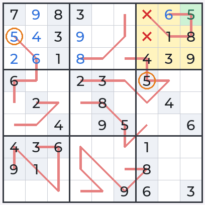

<!-- Written by tools/walkthrough.py parity-lines: edit the script, not this page. -->
# Parity Lines, step 9: the 5 in box 3

**Step 9 of 50** · [← Step 8](step-08.md) · [All steps](../parity-lines.md#the-whole-puzzle-step-by-step) · [Step 10 →](step-10.md)

Box 3 needs a 5. r1c7: column 7 has one (r4c7). r2c7: row 2 has one (r2c1). Only **r1c9** is left: **r1c9 = 5**.

**Step 9 of 50** · [← Step 8](step-08.md) · [All steps](../parity-lines.md#the-whole-puzzle-step-by-step) · [Step 10 →](step-10.md)
