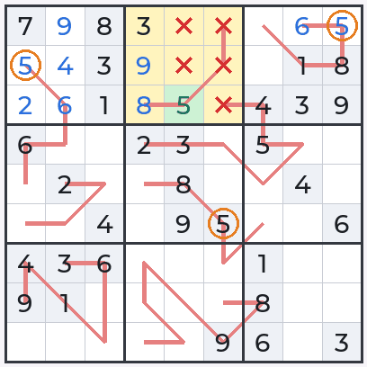

<!-- Written by tools/walkthrough.py parity-lines: edit the script, not this page. -->
# Parity Lines, step 10: the 5 in box 2

**Step 10 of 50** · [← Step 9](step-09.md) · [All steps](../parity-lines.md#the-whole-puzzle-step-by-step) · [Step 11 →](step-11.md)

Box 2 needs a 5. r1c5 and r1c6: row 1 has one (r1c9). r2c5 and r2c6: row 2 has one (r2c1). r3c6: column 6 has one (r6c6). Only **r3c5** is left: **r3c5 = 5**.

**Step 10 of 50** · [← Step 9](step-09.md) · [All steps](../parity-lines.md#the-whole-puzzle-step-by-step) · [Step 11 →](step-11.md)
