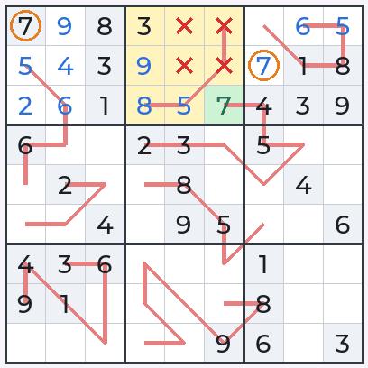

<!-- Written by tools/walkthrough.py parity-lines: edit the script, not this page. -->
# Parity Lines, step 12: the 7 in box 2

**Step 12 of 50** · [← Step 11](step-11.md) · [All steps](../parity-lines.md#the-whole-puzzle-step-by-step) · [Step 13 →](step-13.md)

Box 2 needs a 7. r1c5 and r1c6: row 1 has one (r1c1). r2c5 and r2c6: row 2 has one (r2c7). Only **r3c6** is left: **r3c6 = 7**.

**Step 12 of 50** · [← Step 11](step-11.md) · [All steps](../parity-lines.md#the-whole-puzzle-step-by-step) · [Step 13 →](step-13.md)
