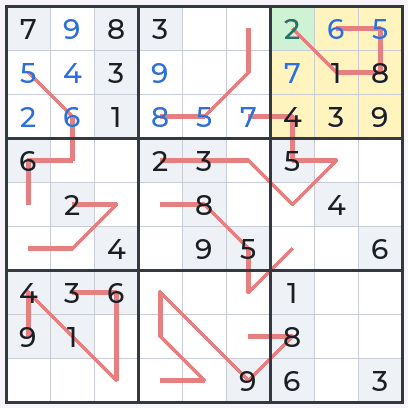

<!-- Written by tools/walkthrough.py parity-lines: edit the script, not this page. -->
# Parity Lines, step 13: the 2 in box 3

**Step 13 of 50** · [← Step 12](step-12.md) · [All steps](../parity-lines.md#the-whole-puzzle-step-by-step) · [Step 14 →](step-14.md)

Box 3 needs a 2, and r1c7 is its last empty cell: **r1c7 = 2**.

**Step 13 of 50** · [← Step 12](step-12.md) · [All steps](../parity-lines.md#the-whole-puzzle-step-by-step) · [Step 14 →](step-14.md)
