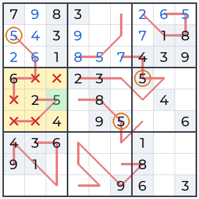

<!-- Written by tools/walkthrough.py parity-lines: edit the script, not this page. -->
# Parity Lines, step 14: the 5 in box 4

**Step 14 of 50** · [← Step 13](step-13.md) · [All steps](../parity-lines.md#the-whole-puzzle-step-by-step) · [Step 15 →](step-15.md)

Box 4 needs a 5. r4c2 and r4c3: row 4 has one (r4c7). r5c1: column 1 has one (r2c1). r6c1 and r6c2: row 6 has one (r6c6). Only **r5c3** is left: **r5c3 = 5**.

**Step 14 of 50** · [← Step 13](step-13.md) · [All steps](../parity-lines.md#the-whole-puzzle-step-by-step) · [Step 15 →](step-15.md)
