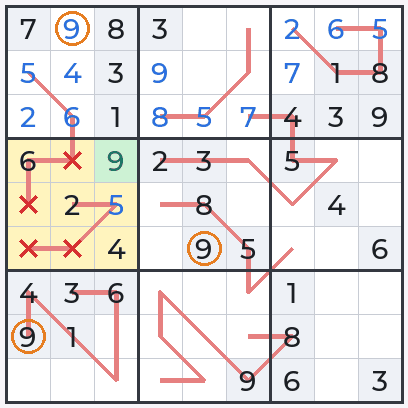

<!-- Written by tools/walkthrough.py parity-lines: edit the script, not this page. -->
# Parity Lines, step 15: the 9 in box 4

**Step 15 of 50** · [← Step 14](step-14.md) · [All steps](../parity-lines.md#the-whole-puzzle-step-by-step) · [Step 16 →](step-16.md)

Box 4 needs a 9. r4c2: column 2 has one (r1c2). r5c1: column 1 has one (r8c1). r6c1 and r6c2: row 6 has one (r6c5). Only **r4c3** is left: **r4c3 = 9**.

**Step 15 of 50** · [← Step 14](step-14.md) · [All steps](../parity-lines.md#the-whole-puzzle-step-by-step) · [Step 16 →](step-16.md)
