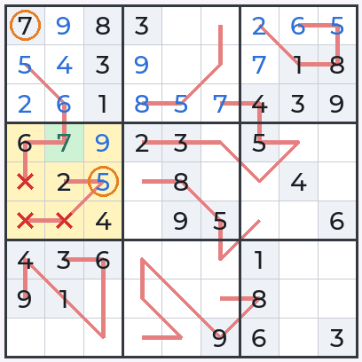

<!-- Written by tools/walkthrough.py parity-lines: edit the script, not this page. -->
# Parity Lines, step 16: the 7 in box 4

**Step 16 of 50** · [← Step 15](step-15.md) · [All steps](../parity-lines.md#the-whole-puzzle-step-by-step) · [Step 17 →](step-17.md)

Box 4 needs a 7. r5c1 and r6c1: column 1 has one (r1c1). r6c2: it's next to the 5 in r5c3 on a red line, and 7 is odd too. Only **r4c2** is left: **r4c2 = 7**.

**Step 16 of 50** · [← Step 15](step-15.md) · [All steps](../parity-lines.md#the-whole-puzzle-step-by-step) · [Step 17 →](step-17.md)
