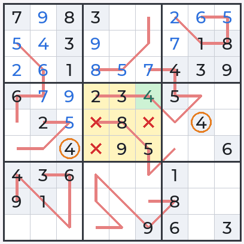

<!-- Written by tools/walkthrough.py parity-lines: edit the script, not this page. -->
# Parity Lines, step 17: the 4 in box 5

**Step 17 of 50** · [← Step 16](step-16.md) · [All steps](../parity-lines.md#the-whole-puzzle-step-by-step) · [Step 18 →](step-18.md)

Box 5 needs a 4. r5c4 and r5c6: row 5 has one (r5c8). r6c4: row 6 has one (r6c3). Only **r4c6** is left: **r4c6 = 4**.

**Step 17 of 50** · [← Step 16](step-16.md) · [All steps](../parity-lines.md#the-whole-puzzle-step-by-step) · [Step 18 →](step-18.md)
