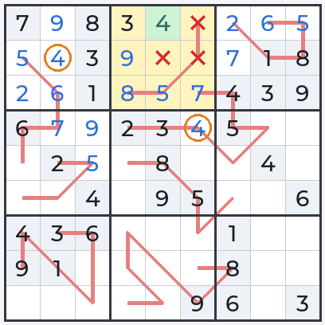

<!-- Written by tools/walkthrough.py parity-lines: edit the script, not this page. -->
# Parity Lines, step 18: the 4 in box 2

**Step 18 of 50** · [← Step 17](step-17.md) · [All steps](../parity-lines.md#the-whole-puzzle-step-by-step) · [Step 19 →](step-19.md)

Box 2 needs a 4. r1c6: column 6 has one (r4c6). r2c5 and r2c6: row 2 has one (r2c2). Only **r1c5** is left: **r1c5 = 4**.

**Step 18 of 50** · [← Step 17](step-17.md) · [All steps](../parity-lines.md#the-whole-puzzle-step-by-step) · [Step 19 →](step-19.md)
