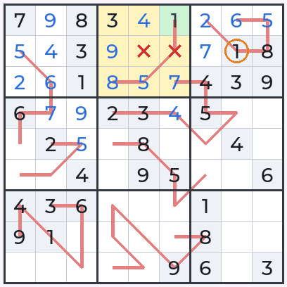

<!-- Written by tools/walkthrough.py parity-lines: edit the script, not this page. -->
# Parity Lines, step 19: the 1 in box 2

**Step 19 of 50** · [← Step 18](step-18.md) · [All steps](../parity-lines.md#the-whole-puzzle-step-by-step) · [Step 20 →](step-20.md)

Box 2 needs a 1. r2c5 and r2c6: row 2 has one (r2c8). Only **r1c6** is left: **r1c6 = 1**.

**Step 19 of 50** · [← Step 18](step-18.md) · [All steps](../parity-lines.md#the-whole-puzzle-step-by-step) · [Step 20 →](step-20.md)
