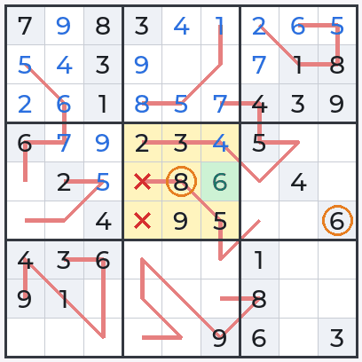

<!-- Written by tools/walkthrough.py parity-lines: edit the script, not this page. -->
# Parity Lines, step 20: the 6 in box 5

**Step 20 of 50** · [← Step 19](step-19.md) · [All steps](../parity-lines.md#the-whole-puzzle-step-by-step) · [Step 21 →](step-21.md)

Box 5 needs a 6. r6c4: row 6 has one (r6c9). r5c4: it's next to the 8 in r5c5 on a red line, and 6 is even too. Only **r5c6** is left: **r5c6 = 6**.

**Step 20 of 50** · [← Step 19](step-19.md) · [All steps](../parity-lines.md#the-whole-puzzle-step-by-step) · [Step 21 →](step-21.md)
