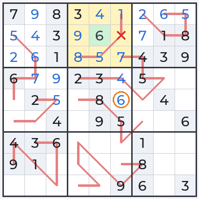

<!-- Written by tools/walkthrough.py parity-lines: edit the script, not this page. -->
# Parity Lines, step 21: the 6 in box 2

**Step 21 of 50** · [← Step 20](step-20.md) · [All steps](../parity-lines.md#the-whole-puzzle-step-by-step) · [Step 22 →](step-22.md)

Box 2 needs a 6. r2c6: column 6 has one (r5c6). Only **r2c5** is left: **r2c5 = 6**.

**Step 21 of 50** · [← Step 20](step-20.md) · [All steps](../parity-lines.md#the-whole-puzzle-step-by-step) · [Step 22 →](step-22.md)
