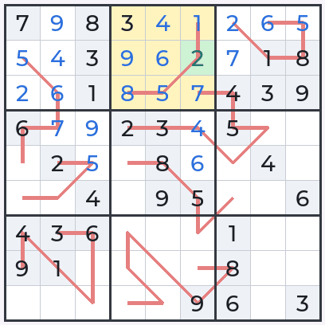

<!-- Written by tools/walkthrough.py parity-lines: edit the script, not this page. -->
# Parity Lines, step 22: the 2 in box 2

**Step 22 of 50** · [← Step 21](step-21.md) · [All steps](../parity-lines.md#the-whole-puzzle-step-by-step) · [Step 23 →](step-23.md)

Box 2 needs a 2, and r2c6 is its last empty cell: **r2c6 = 2**.

**Step 22 of 50** · [← Step 21](step-21.md) · [All steps](../parity-lines.md#the-whole-puzzle-step-by-step) · [Step 23 →](step-23.md)
