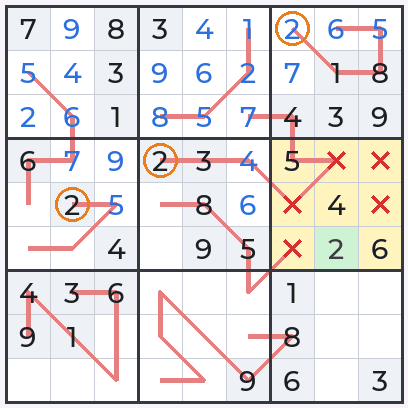

<!-- Written by tools/walkthrough.py parity-lines: edit the script, not this page. -->
# Parity Lines, step 23: the 2 in box 6

**Step 23 of 50** · [← Step 22](step-22.md) · [All steps](../parity-lines.md#the-whole-puzzle-step-by-step) · [Step 24 →](step-24.md)

Box 6 needs a 2. r4c8 and r4c9: row 4 has one (r4c4). r5c7 and r5c9: row 5 has one (r5c2). r6c7: column 7 has one (r1c7). Only **r6c8** is left: **r6c8 = 2**.

**Step 23 of 50** · [← Step 22](step-22.md) · [All steps](../parity-lines.md#the-whole-puzzle-step-by-step) · [Step 24 →](step-24.md)
