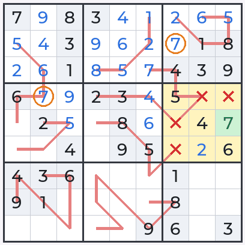

<!-- Written by tools/walkthrough.py parity-lines: edit the script, not this page. -->
# Parity Lines, step 24: the 7 in box 6

**Step 24 of 50** · [← Step 23](step-23.md) · [All steps](../parity-lines.md#the-whole-puzzle-step-by-step) · [Step 25 →](step-25.md)

Box 6 needs a 7. r4c8 and r4c9: row 4 has one (r4c2). r5c7 and r6c7: column 7 has one (r2c7). Only **r5c9** is left: **r5c9 = 7**.

**Step 24 of 50** · [← Step 23](step-23.md) · [All steps](../parity-lines.md#the-whole-puzzle-step-by-step) · [Step 25 →](step-25.md)
