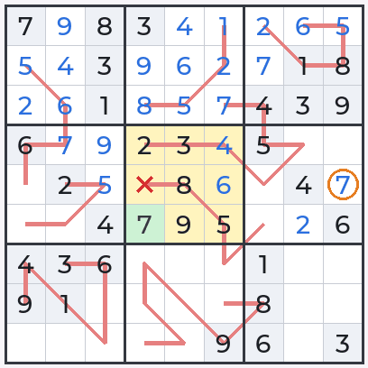

<!-- Written by tools/walkthrough.py parity-lines: edit the script, not this page. -->
# Parity Lines, step 25: the 7 in box 5

**Step 25 of 50** · [← Step 24](step-24.md) · [All steps](../parity-lines.md#the-whole-puzzle-step-by-step) · [Step 26 →](step-26.md)

Box 5 needs a 7. r5c4: row 5 has one (r5c9). Only **r6c4** is left: **r6c4 = 7**.

**Step 25 of 50** · [← Step 24](step-24.md) · [All steps](../parity-lines.md#the-whole-puzzle-step-by-step) · [Step 26 →](step-26.md)
