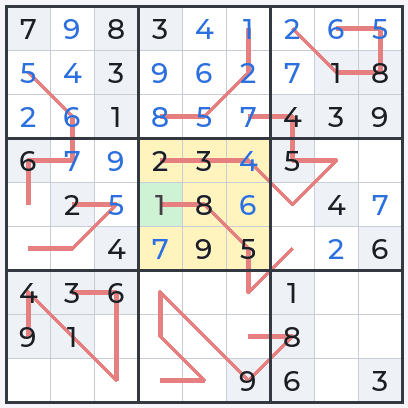

<!-- Written by tools/walkthrough.py parity-lines: edit the script, not this page. -->
# Parity Lines, step 26: the 1 in box 5

**Step 26 of 50** · [← Step 25](step-25.md) · [All steps](../parity-lines.md#the-whole-puzzle-step-by-step) · [Step 27 →](step-27.md)

Box 5 needs a 1, and r5c4 is its last empty cell: **r5c4 = 1**.

**Step 26 of 50** · [← Step 25](step-25.md) · [All steps](../parity-lines.md#the-whole-puzzle-step-by-step) · [Step 27 →](step-27.md)
