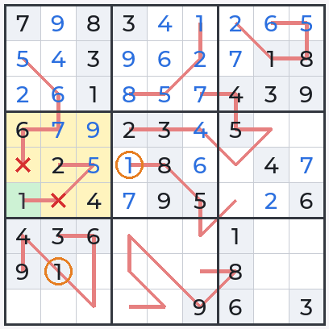

<!-- Written by tools/walkthrough.py parity-lines: edit the script, not this page. -->
# Parity Lines, step 27: the 1 in box 4

**Step 27 of 50** · [← Step 26](step-26.md) · [All steps](../parity-lines.md#the-whole-puzzle-step-by-step) · [Step 28 →](step-28.md)

Box 4 needs a 1. r5c1: row 5 has one (r5c4). r6c2: column 2 has one (r8c2). Only **r6c1** is left: **r6c1 = 1**.

**Step 27 of 50** · [← Step 26](step-26.md) · [All steps](../parity-lines.md#the-whole-puzzle-step-by-step) · [Step 28 →](step-28.md)
