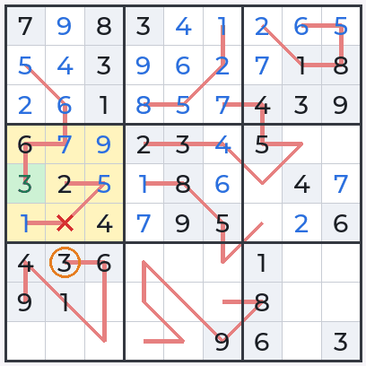

<!-- Written by tools/walkthrough.py parity-lines: edit the script, not this page. -->
# Parity Lines, step 28: the 3 in box 4

**Step 28 of 50** · [← Step 27](step-27.md) · [All steps](../parity-lines.md#the-whole-puzzle-step-by-step) · [Step 29 →](step-29.md)

Box 4 needs a 3. r6c2: column 2 has one (r7c2). Only **r5c1** is left: **r5c1 = 3**.

**Step 28 of 50** · [← Step 27](step-27.md) · [All steps](../parity-lines.md#the-whole-puzzle-step-by-step) · [Step 29 →](step-29.md)
