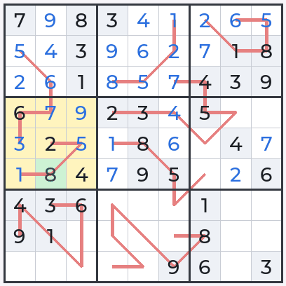

<!-- Written by tools/walkthrough.py parity-lines: edit the script, not this page. -->
# Parity Lines, step 29: the 8 in box 4

**Step 29 of 50** · [← Step 28](step-28.md) · [All steps](../parity-lines.md#the-whole-puzzle-step-by-step) · [Step 30 →](step-30.md)

Box 4 needs an 8, and r6c2 is its last empty cell: **r6c2 = 8**.

**Step 29 of 50** · [← Step 28](step-28.md) · [All steps](../parity-lines.md#the-whole-puzzle-step-by-step) · [Step 30 →](step-30.md)
