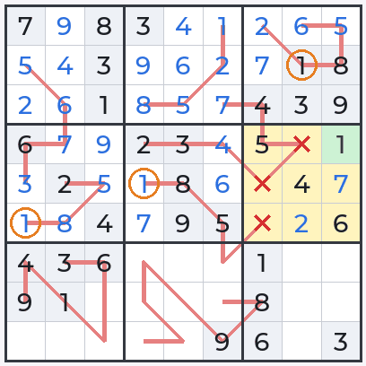

<!-- Written by tools/walkthrough.py parity-lines: edit the script, not this page. -->
# Parity Lines, step 30: the 1 in box 6

**Step 30 of 50** · [← Step 29](step-29.md) · [All steps](../parity-lines.md#the-whole-puzzle-step-by-step) · [Step 31 →](step-31.md)

Box 6 needs a 1. r4c8: column 8 has one (r2c8). r5c7: row 5 has one (r5c4). r6c7: row 6 has one (r6c1). Only **r4c9** is left: **r4c9 = 1**.

**Step 30 of 50** · [← Step 29](step-29.md) · [All steps](../parity-lines.md#the-whole-puzzle-step-by-step) · [Step 31 →](step-31.md)
