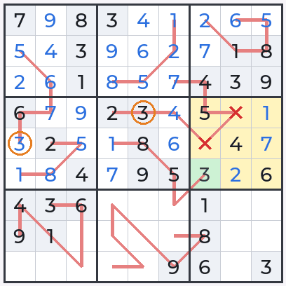

<!-- Written by tools/walkthrough.py parity-lines: edit the script, not this page. -->
# Parity Lines, step 31: the 3 in box 6

**Step 31 of 50** · [← Step 30](step-30.md) · [All steps](../parity-lines.md#the-whole-puzzle-step-by-step) · [Step 32 →](step-32.md)

Box 6 needs a 3. r4c8: row 4 has one (r4c5). r5c7: row 5 has one (r5c1). Only **r6c7** is left: **r6c7 = 3**.

**Step 31 of 50** · [← Step 30](step-30.md) · [All steps](../parity-lines.md#the-whole-puzzle-step-by-step) · [Step 32 →](step-32.md)
