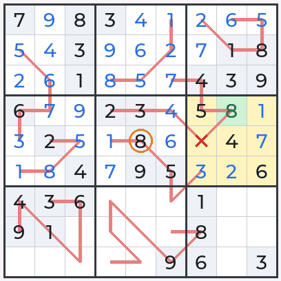

<!-- Written by tools/walkthrough.py parity-lines: edit the script, not this page. -->
# Parity Lines, step 32: the 8 in box 6

**Step 32 of 50** · [← Step 31](step-31.md) · [All steps](../parity-lines.md#the-whole-puzzle-step-by-step) · [Step 33 →](step-33.md)

Box 6 needs an 8. r5c7: row 5 has one (r5c5). Only **r4c8** is left: **r4c8 = 8**.

**Step 32 of 50** · [← Step 31](step-31.md) · [All steps](../parity-lines.md#the-whole-puzzle-step-by-step) · [Step 33 →](step-33.md)
