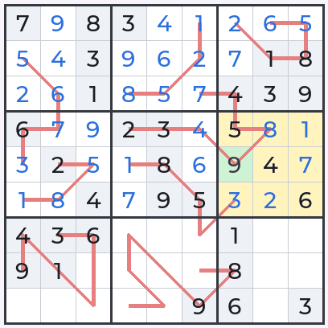

<!-- Written by tools/walkthrough.py parity-lines: edit the script, not this page. -->
# Parity Lines, step 33: the 9 in box 6

**Step 33 of 50** · [← Step 32](step-32.md) · [All steps](../parity-lines.md#the-whole-puzzle-step-by-step) · [Step 34 →](step-34.md)

Box 6 needs a 9, and r5c7 is its last empty cell: **r5c7 = 9**.

**Step 33 of 50** · [← Step 32](step-32.md) · [All steps](../parity-lines.md#the-whole-puzzle-step-by-step) · [Step 34 →](step-34.md)
