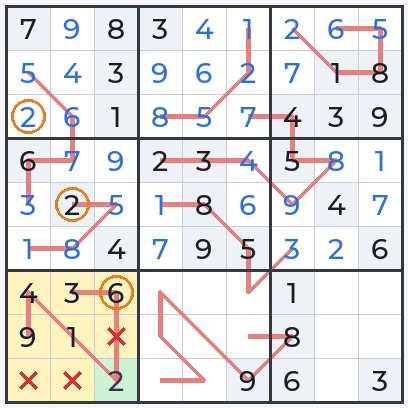

<!-- Written by tools/walkthrough.py parity-lines: edit the script, not this page. -->
# Parity Lines, step 34: the 2 in box 7

**Step 34 of 50** · [← Step 33](step-33.md) · [All steps](../parity-lines.md#the-whole-puzzle-step-by-step) · [Step 35 →](step-35.md)

Box 7 needs a 2. r9c1: column 1 has one (r3c1). r9c2: column 2 has one (r5c2). r8c3: it's next to the 6 in r7c3 on a red line, and 2 is even too. Only **r9c3** is left: **r9c3 = 2**.

**Step 34 of 50** · [← Step 33](step-33.md) · [All steps](../parity-lines.md#the-whole-puzzle-step-by-step) · [Step 35 →](step-35.md)
