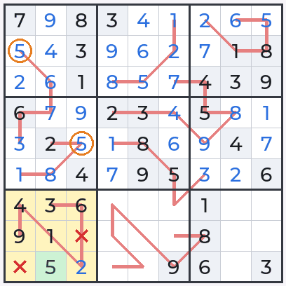

<!-- Written by tools/walkthrough.py parity-lines: edit the script, not this page. -->
# Parity Lines, step 35: the 5 in box 7

**Step 35 of 50** · [← Step 34](step-34.md) · [All steps](../parity-lines.md#the-whole-puzzle-step-by-step) · [Step 36 →](step-36.md)

Box 7 needs a 5. r8c3: column 3 has one (r5c3). r9c1: column 1 has one (r2c1). Only **r9c2** is left: **r9c2 = 5**.

**Step 35 of 50** · [← Step 34](step-34.md) · [All steps](../parity-lines.md#the-whole-puzzle-step-by-step) · [Step 36 →](step-36.md)
