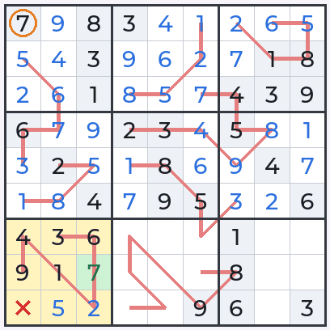

<!-- Written by tools/walkthrough.py parity-lines: edit the script, not this page. -->
# Parity Lines, step 36: the 7 in box 7

**Step 36 of 50** · [← Step 35](step-35.md) · [All steps](../parity-lines.md#the-whole-puzzle-step-by-step) · [Step 37 →](step-37.md)

Box 7 needs a 7. r9c1: column 1 has one (r1c1). Only **r8c3** is left: **r8c3 = 7**.

**Step 36 of 50** · [← Step 35](step-35.md) · [All steps](../parity-lines.md#the-whole-puzzle-step-by-step) · [Step 37 →](step-37.md)
