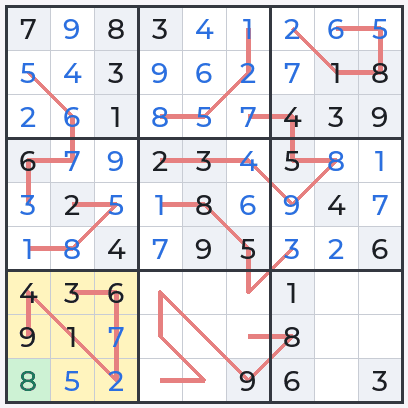

<!-- Written by tools/walkthrough.py parity-lines: edit the script, not this page. -->
# Parity Lines, step 37: the 8 in box 7

**Step 37 of 50** · [← Step 36](step-36.md) · [All steps](../parity-lines.md#the-whole-puzzle-step-by-step) · [Step 38 →](step-38.md)

Box 7 needs an 8, and r9c1 is its last empty cell: **r9c1 = 8**.

**Step 37 of 50** · [← Step 36](step-36.md) · [All steps](../parity-lines.md#the-whole-puzzle-step-by-step) · [Step 38 →](step-38.md)
