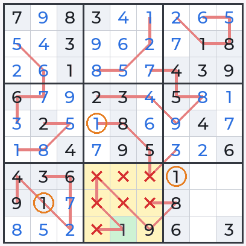

<!-- Written by tools/walkthrough.py parity-lines: edit the script, not this page. -->
# Parity Lines, step 38: the 1 in box 8

**Step 38 of 50** · [← Step 37](step-37.md) · [All steps](../parity-lines.md#the-whole-puzzle-step-by-step) · [Step 39 →](step-39.md)

Box 8 needs a 1. r7c4, r7c5 and r7c6: row 7 has one (r7c7). r8c4, r8c5 and r8c6: row 8 has one (r8c2). r9c4: column 4 has one (r5c4). Only **r9c5** is left: **r9c5 = 1**.

**Step 38 of 50** · [← Step 37](step-37.md) · [All steps](../parity-lines.md#the-whole-puzzle-step-by-step) · [Step 39 →](step-39.md)
