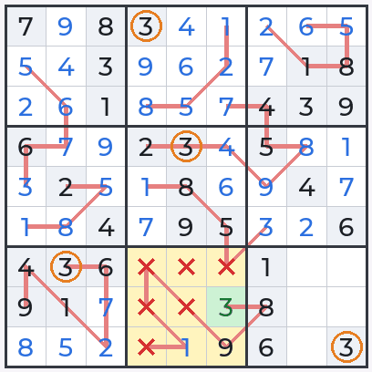

<!-- Written by tools/walkthrough.py parity-lines: edit the script, not this page. -->
# Parity Lines, step 39: the 3 in box 8

**Step 39 of 50** · [← Step 38](step-38.md) · [All steps](../parity-lines.md#the-whole-puzzle-step-by-step) · [Step 40 →](step-40.md)

Box 8 needs a 3. r7c4, r7c5 and r7c6: row 7 has one (r7c2). r8c4: column 4 has one (r1c4). r8c5: column 5 has one (r4c5). r9c4: row 9 has one (r9c9). Only **r8c6** is left: **r8c6 = 3**.

**Step 39 of 50** · [← Step 38](step-38.md) · [All steps](../parity-lines.md#the-whole-puzzle-step-by-step) · [Step 40 →](step-40.md)
