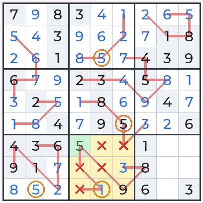

<!-- Written by tools/walkthrough.py parity-lines: edit the script, not this page. -->
# Parity Lines, step 40: the 5 in box 8

**Step 40 of 50** · [← Step 39](step-39.md) · [All steps](../parity-lines.md#the-whole-puzzle-step-by-step) · [Step 41 →](step-41.md)

Box 8 needs a 5. r7c5 and r8c5: column 5 has one (r3c5). r7c6: column 6 has one (r6c6). r9c4: row 9 has one (r9c2). r8c4: it's next to the 1 in r9c5 on a red line, and 5 is odd too. Only **r7c4** is left: **r7c4 = 5**.

**Step 40 of 50** · [← Step 39](step-39.md) · [All steps](../parity-lines.md#the-whole-puzzle-step-by-step) · [Step 41 →](step-41.md)
