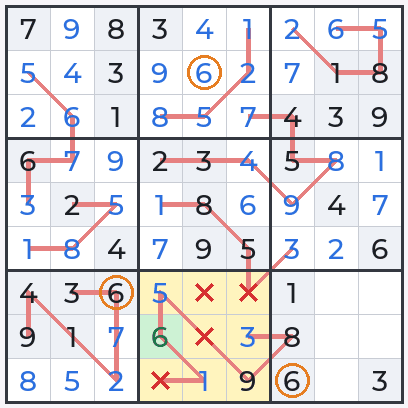

<!-- Written by tools/walkthrough.py parity-lines: edit the script, not this page. -->
# Parity Lines, step 41: the 6 in box 8

**Step 41 of 50** · [← Step 40](step-40.md) · [All steps](../parity-lines.md#the-whole-puzzle-step-by-step) · [Step 42 →](step-42.md)

Box 8 needs a 6. r7c5 and r7c6: row 7 has one (r7c3). r8c5: column 5 has one (r2c5). r9c4: row 9 has one (r9c7). Only **r8c4** is left: **r8c4 = 6**.

**Step 41 of 50** · [← Step 40](step-40.md) · [All steps](../parity-lines.md#the-whole-puzzle-step-by-step) · [Step 42 →](step-42.md)
