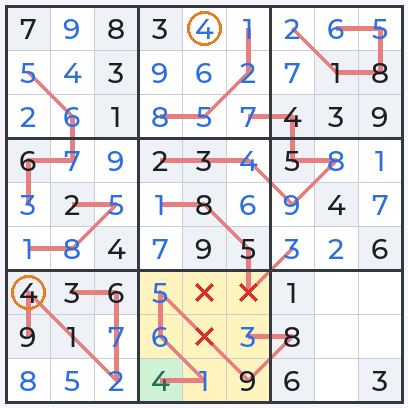

<!-- Written by tools/walkthrough.py parity-lines: edit the script, not this page. -->
# Parity Lines, step 42: the 4 in box 8

**Step 42 of 50** · [← Step 41](step-41.md) · [All steps](../parity-lines.md#the-whole-puzzle-step-by-step) · [Step 43 →](step-43.md)

Box 8 needs a 4. r7c5 and r7c6: row 7 has one (r7c1). r8c5: column 5 has one (r1c5). Only **r9c4** is left: **r9c4 = 4**.

**Step 42 of 50** · [← Step 41](step-41.md) · [All steps](../parity-lines.md#the-whole-puzzle-step-by-step) · [Step 43 →](step-43.md)
