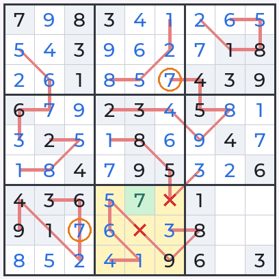

<!-- Written by tools/walkthrough.py parity-lines: edit the script, not this page. -->
# Parity Lines, step 43: the 7 in box 8

**Step 43 of 50** · [← Step 42](step-42.md) · [All steps](../parity-lines.md#the-whole-puzzle-step-by-step) · [Step 44 →](step-44.md)

Box 8 needs a 7. r7c6: column 6 has one (r3c6). r8c5: row 8 has one (r8c3). Only **r7c5** is left: **r7c5 = 7**.

**Step 43 of 50** · [← Step 42](step-42.md) · [All steps](../parity-lines.md#the-whole-puzzle-step-by-step) · [Step 44 →](step-44.md)
