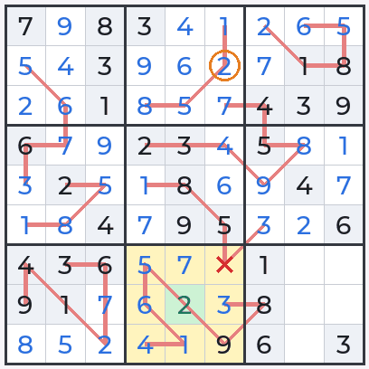

<!-- Written by tools/walkthrough.py parity-lines: edit the script, not this page. -->
# Parity Lines, step 44: the 2 in box 8

**Step 44 of 50** · [← Step 43](step-43.md) · [All steps](../parity-lines.md#the-whole-puzzle-step-by-step) · [Step 45 →](step-45.md)

Box 8 needs a 2. r7c6: column 6 has one (r2c6). Only **r8c5** is left: **r8c5 = 2**.

**Step 44 of 50** · [← Step 43](step-43.md) · [All steps](../parity-lines.md#the-whole-puzzle-step-by-step) · [Step 45 →](step-45.md)
