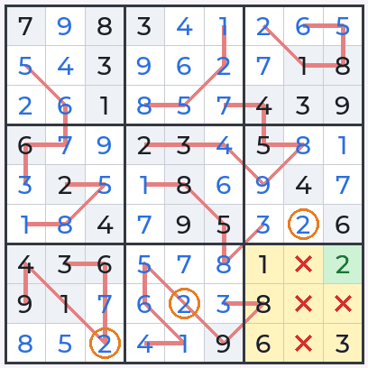

<!-- Written by tools/walkthrough.py parity-lines: edit the script, not this page. -->
# Parity Lines, step 46: the 2 in box 9

**Step 46 of 50** · [← Step 45](step-45.md) · [All steps](../parity-lines.md#the-whole-puzzle-step-by-step) · [Step 47 →](step-47.md)

Box 9 needs a 2. r7c8: column 8 has one (r6c8). r8c8 and r8c9: row 8 has one (r8c5). r9c8: row 9 has one (r9c3). Only **r7c9** is left: **r7c9 = 2**.

**Step 46 of 50** · [← Step 45](step-45.md) · [All steps](../parity-lines.md#the-whole-puzzle-step-by-step) · [Step 47 →](step-47.md)
