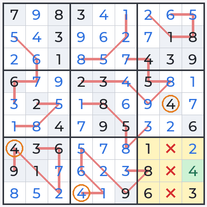

<!-- Written by tools/walkthrough.py parity-lines: edit the script, not this page. -->
# Parity Lines, step 47: the 4 in box 9

**Step 47 of 50** · [← Step 46](step-46.md) · [All steps](../parity-lines.md#the-whole-puzzle-step-by-step) · [Step 48 →](step-48.md)

Box 9 needs a 4. r7c8: row 7 has one (r7c1). r8c8: column 8 has one (r5c8). r9c8: row 9 has one (r9c4). Only **r8c9** is left: **r8c9 = 4**.

**Step 47 of 50** · [← Step 46](step-46.md) · [All steps](../parity-lines.md#the-whole-puzzle-step-by-step) · [Step 48 →](step-48.md)
