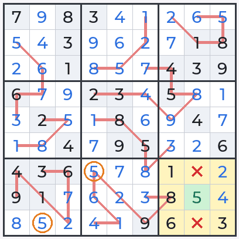

<!-- Written by tools/walkthrough.py parity-lines: edit the script, not this page. -->
# Parity Lines, step 48: the 5 in box 9

**Step 48 of 50** · [← Step 47](step-47.md) · [All steps](../parity-lines.md#the-whole-puzzle-step-by-step) · [Step 49 →](step-49.md)

Box 9 needs a 5. r7c8: row 7 has one (r7c4). r9c8: row 9 has one (r9c2). Only **r8c8** is left: **r8c8 = 5**.

**Step 48 of 50** · [← Step 47](step-47.md) · [All steps](../parity-lines.md#the-whole-puzzle-step-by-step) · [Step 49 →](step-49.md)
