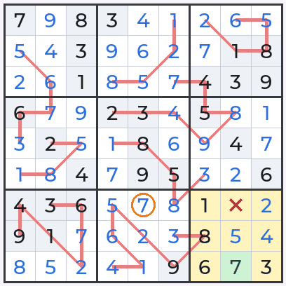

<!-- Written by tools/walkthrough.py parity-lines: edit the script, not this page. -->
# Parity Lines, step 49: the 7 in box 9

**Step 49 of 50** · [← Step 48](step-48.md) · [All steps](../parity-lines.md#the-whole-puzzle-step-by-step) · [Step 50 →](step-50.md)

Box 9 needs a 7. r7c8: row 7 has one (r7c5). Only **r9c8** is left: **r9c8 = 7**.

**Step 49 of 50** · [← Step 48](step-48.md) · [All steps](../parity-lines.md#the-whole-puzzle-step-by-step) · [Step 50 →](step-50.md)
