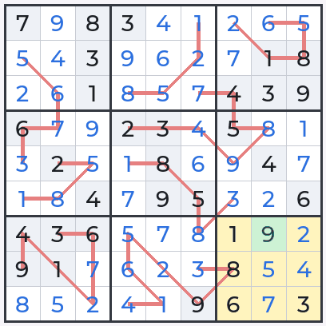

<!-- Written by tools/walkthrough.py parity-lines: edit the script, not this page. -->
# Parity Lines, step 50: the 9 in box 9

**Step 50 of 50** · [← Step 49](step-49.md) · [All steps](../parity-lines.md#the-whole-puzzle-step-by-step) · [All steps](../parity-lines.md#the-whole-puzzle-step-by-step)

Box 9 needs a 9, and r7c8 is its last empty cell: **r7c8 = 9**.

Solved.

**Step 50 of 50** · [← Step 49](step-49.md) · [All steps](../parity-lines.md#the-whole-puzzle-step-by-step) · [All steps](../parity-lines.md#the-whole-puzzle-step-by-step)
