# Pill Arrows

[← All variants](README.md) · [Puzzles](../features-puzzles.md) · [How to play](../how-to-play.md)

## The rules

[Classic](classic.md) rules, and **arrows** whose circle is a **pill**: two cells side by side (or one above the other) in a capsule, read as a **two-digit number**, left to right or top to bottom. The digits along the arrow's shaft **add up to that number**. A pill of 1 and 2 reads 12, so its shaft could be 3, 4, 5. Digits may repeat along a shaft where the rules allow.

## On the board

- The pill is a grey capsule over two cells; the shaft runs from its second cell to an arrowhead.
- With the pill filled, the arrow's digits turn red when the shaft adds up to more than it (counting 1 for each empty cell), or, all filled, to something else.
- The grader and hints: "The arrow's shaft adds up to its pill, the two cells read as a two-digit number, so row 5, column 4 can only be 2."
- **Puzzles → ⋮ → New puzzle → Lines → Pill Arrow**: 8 arrows (Hard and Expert: 10); the generator keeps pills under 40.

## How to solve it

- **The pill's first digit is small:** a shaft of n cells adds up to 9n at most, so a pill on a 3-cell shaft is under 28: its tens are 1 or 2.
- **The tens do most of the work:** a pill of 2x needs a shaft of 20 to 29.
- **Then the units:** with the shaft filled but one cell, the pill's last digit, or the shaft's, is a subtraction.

## Worked example

**variant-examples #56**, Pill Arrows Easy (see [Classic](classic.md#worked-example-the-whole-puzzle) for how to import the examples; cells are written r*row*c*column*).

**Step 1: r5c4.** Column 4 has 1, 7 and 8; row 5 has 3, 4, 5 and 6: that leaves 2 and 9. r5c4 is the first cell of a pill (with r5c5), whose shaft has 4 cells: 4 cells add up to 36 at most, and a pill starting with 9 is 91 or more. **r5c4 = 2**.

**Step 2: the 5 in column 7.** r1c7 is the first cell of a pill with the 6 in r1c8. Its shaft of 7 cells holds 7, 6, 6, 3 and 4 (26) and two empty cells, so it adds up to 44 at most (both can be 9: they share no row, column or box): a pill of 56 is too much. Of the rest, r2c7, r5c7 and r6c7 are filled, r4c7 sees the 5 in r5c9, r7c7 the one in r7c6, r8c7 the one in r8c8 and r9c7 the one in r9c2. **r3c7 = 5**.

**Step 3: the 8 in column 7**, the same way: a pill of 86 is far too much for r1c7. **r4c7 = 8**.

## The whole puzzle, step by step

<!-- walkthrough -->
<!-- Written by tools/walkthrough.py pill-arrows: edit the script, not this part. -->

The whole puzzle, from the start to the last cell: 51 steps, each one a single (one place left for a digit, or one digit left for a cell), taken in the order a box's single comes first, so not quite the order of the worked example above. In each picture, the unit the step looks at is tinted yellow (for a cell with one digit left: its row, column and box), the new digit is on green, the digits that rule cells out have an **orange ring**, and the empty cells they rule out a **red cross**. Givens are on grey, digits from earlier steps in blue.

#### Step 1: the 5 in box 2

Box 2 needs a 5. r1c6: column 6 has one (r7c6). r2c5 and r3c5: column 5 has one (r6c5). Only **r1c4** is left: **r1c4 = 5**.

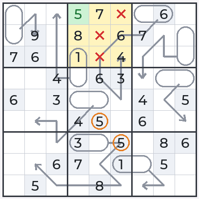

#### Step 2: the 5 in box 3

Box 3 needs a 5. r1c7 and r1c9: row 1 has one (r1c4). r2c8 and r3c8: column 8 has one (r8c8). r2c9 and r3c9: column 9 has one (r5c9). Only **r3c7** is left: **r3c7 = 5**.

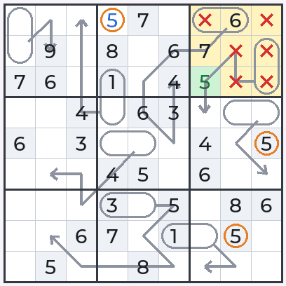

#### Step 3: the 5 in box 4

Box 4 needs a 5. r4c2: column 2 has one (r9c2). r5c2: row 5 has one (r5c9). r6c1, r6c2 and r6c3: row 6 has one (r6c5). Only **r4c1** is left: **r4c1 = 5**.

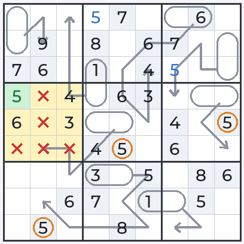

#### Step 4: the 5 in box 1

Box 1 needs a 5. r1c1, r1c2 and r1c3: row 1 has one (r1c4). r2c1: column 1 has one (r4c1). r3c3: row 3 has one (r3c7). Only **r2c3** is left: **r2c3 = 5**.

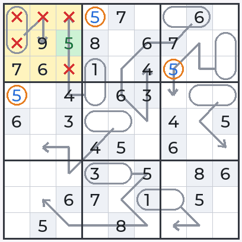

#### Step 5: the 1 in box 5

Box 5 needs a 1. r4c4 and r5c4: column 4 has one (r3c4). r5c6 and r6c6: column 6 has one (r8c6). Only **r5c5** is left: **r5c5 = 1**.

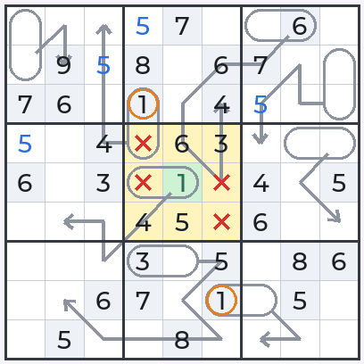

#### Step 6: the 6 in box 8

Box 8 needs a 6. r7c5: row 7 has one (r7c9). r8c5: row 8 has one (r8c3). r9c6: column 6 has one (r2c6). Only **r9c4** is left: **r9c4 = 6**.

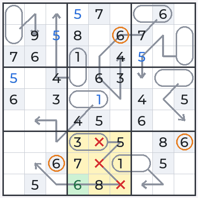

#### Step 7: the 9 in column 4

Column 4 needs a 9. r5c4: it's a pill's first digit, its tens: a shaft of up to 7 cells adds up to 63 at most. Only **r4c4** is left: **r4c4 = 9**.

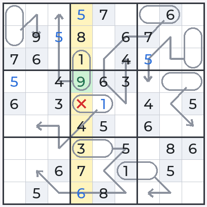

#### Step 8: the 9 in row 5

Row 5 needs a 9. r5c2: column 2 has one (r2c2). r5c4: column 4 has one (r4c4). r5c6: box 5 has one (r4c4). Only **r5c8** is left: **r5c8 = 9**.

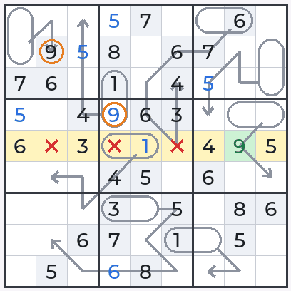

#### Step 9: the 2 in column 4

Column 4 needs a 2, and r5c4 is its last empty cell: **r5c4 = 2**.

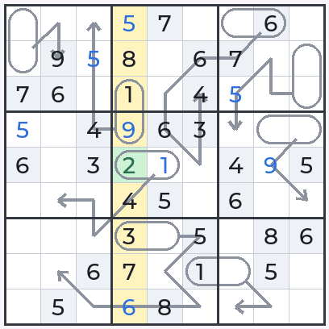

#### Step 10: the 8 in column 7

Column 7 needs an 8. r7c7: row 7 has one (r7c8). r8c7: box 9 has one (r7c8). r9c7: row 9 has one (r9c5). r1c7: it's a pill's first digit, its tens: a shaft of up to 7 cells adds up to 63 at most. Only **r4c7** is left: **r4c7 = 8**.

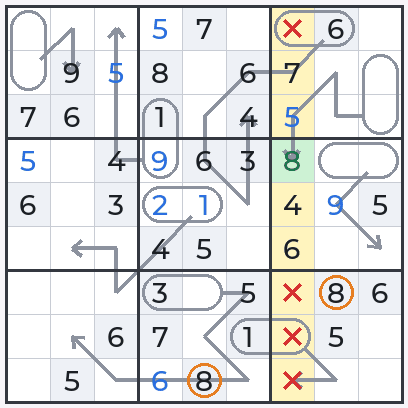

#### Step 11: the 1 in column 7

Column 7 needs a 1. r8c7: row 8 has one (r8c6). r1c7: it's the pill's first digit, its tens, and with a 1 there the shaft can't make the pill's number. r9c7: with a 1 on its shaft, the pill couldn't read as the shaft's sum. Only **r7c7** is left: **r7c7 = 1**.

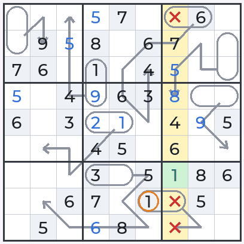

#### Step 12: the 9 in column 7

Column 7 needs a 9. r1c7: it's a pill's first digit, its tens: a shaft of up to 7 cells adds up to 63 at most. r8c7: it's the pill's second digit, and with a 9 there the shaft can't make the pill's number. Only **r9c7** is left: **r9c7 = 9**.

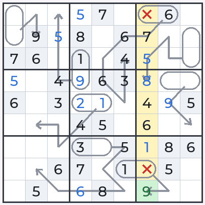

#### Step 13: the 9 in column 6

Column 6 needs a 9. r5c6: row 5 has one (r5c8). r6c6: box 5 has one (r4c4). r9c6: row 9 has one (r9c7). Only **r1c6** is left: **r1c6 = 9**.

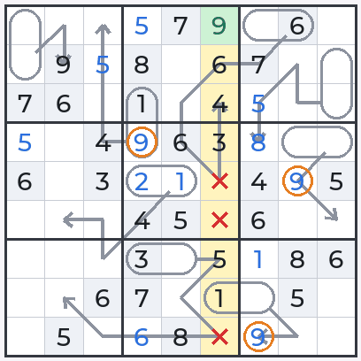

#### Step 14: the 9 in box 3

Box 3 needs a 9. r1c7 and r1c9: row 1 has one (r1c6). r2c8 and r2c9: row 2 has one (r2c2). r3c8: column 8 has one (r5c8). Only **r3c9** is left: **r3c9 = 9**.

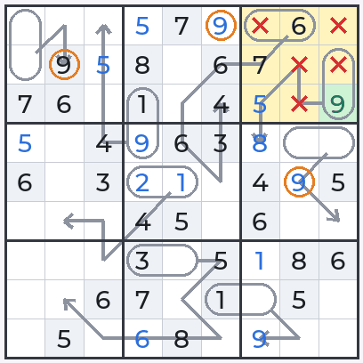

#### Step 15: the 8 in box 3

Box 3 needs an 8. r1c7: column 7 has one (r4c7). r2c8 and r2c9: row 2 has one (r2c4). r3c8: column 8 has one (r7c8). Only **r1c9** is left: **r1c9 = 8**.

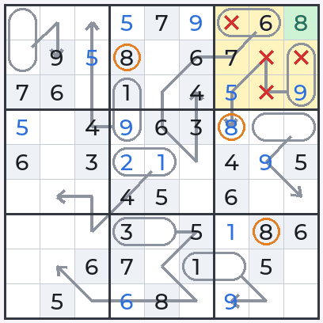

#### Step 16: the 8 in box 1

Box 1 needs an 8. r1c1, r1c2 and r1c3: row 1 has one (r1c9). r2c1: row 2 has one (r2c4). Only **r3c3** is left: **r3c3 = 8**.

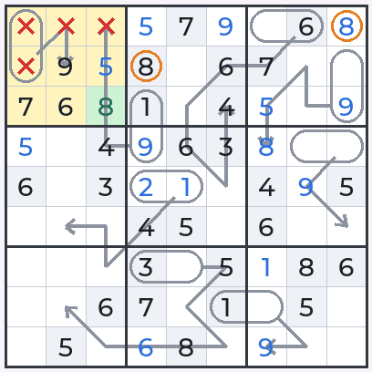

#### Step 17: the 4 in box 3

Box 3 needs a 4. r1c7: column 7 has one (r5c7). r3c8: row 3 has one (r3c6). r2c9: it's the pill's first digit, its tens: with a 4 there the pill would be 41 or more, more than its shaft of 4 cells can make. Only **r2c8** is left: **r2c8 = 4**.

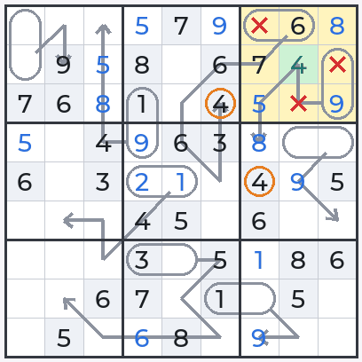

#### Step 18: the 4 in box 1

Box 1 needs a 4. r1c3: column 3 has one (r4c3). r2c1: row 2 has one (r2c8). r1c1: it's the pill's first digit, its tens: with a 4 there the pill would be 41 or more, more than its shaft of 2 cells can make. Only **r1c2** is left: **r1c2 = 4**.

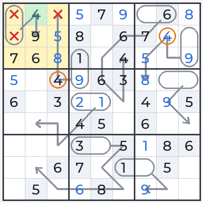

#### Step 19: the 1 in box 1

Box 1 needs a 1. r1c3: the pill reads 19 and the rest of the shaft makes 17, so it's 2. r2c1: it's the pill's second digit, and with a 1 there the shaft can't make the pill's number. Only **r1c1** is left: **r1c1 = 1**.

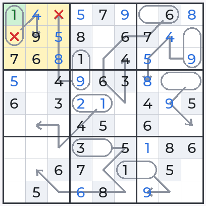

#### Step 20: the 2 in box 1

Box 1 needs a 2. r2c1: it's the pill's second digit: the shaft adds up to 13, so the pill is 13. Only **r1c3** is left: **r1c3 = 2**.

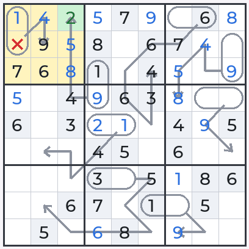

#### Step 21: the 3 in box 1

Box 1 needs a 3, and r2c1 is its last empty cell: **r2c1 = 3**.

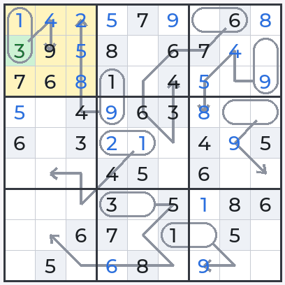

#### Step 22: the 3 in box 2

Box 2 needs a 3. r2c5: row 2 has one (r2c1). Only **r3c5** is left: **r3c5 = 3**.

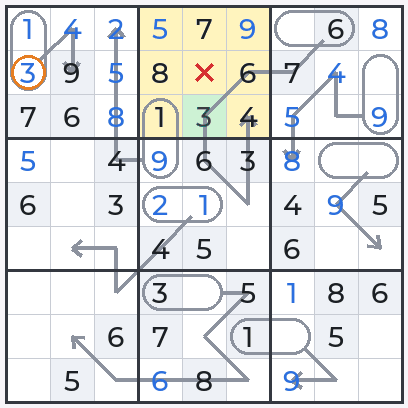

#### Step 23: the 2 in box 2

Box 2 needs a 2, and r2c5 is its last empty cell: **r2c5 = 2**.

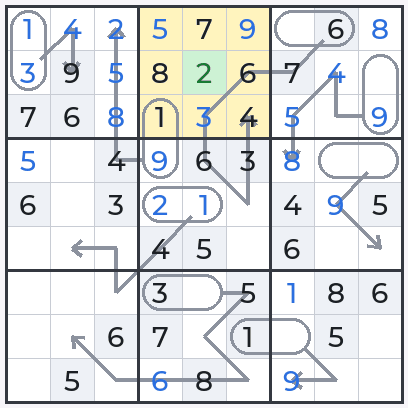

#### Step 24: the 1 in box 3

Box 3 needs a 1. r1c7: row 1 has one (r1c1). r3c8: row 3 has one (r3c4). Only **r2c9** is left: **r2c9 = 1**.

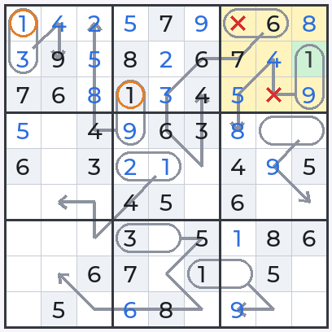

#### Step 25: the 2 in box 3

Box 3 needs a 2. r1c7: row 1 has one (r1c3). Only **r3c8** is left: **r3c8 = 2**.

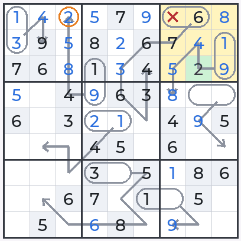

#### Step 26: the 3 in box 3

Box 3 needs a 3, and r1c7 is its last empty cell: **r1c7 = 3**.

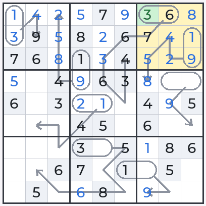

#### Step 27: the 8 in box 5

Box 5 needs an 8. r5c6: the pill reads 36 and the rest of the shaft makes 29, so it's 7. Only **r6c6** is left: **r6c6 = 8**.

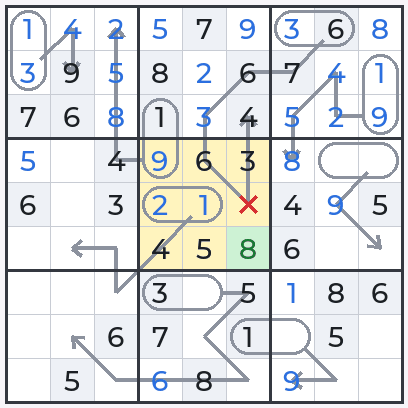

#### Step 28: the 8 in box 4

Box 4 needs an 8. r4c2: row 4 has one (r4c7). r6c1, r6c2 and r6c3: row 6 has one (r6c6). Only **r5c2** is left: **r5c2 = 8**.

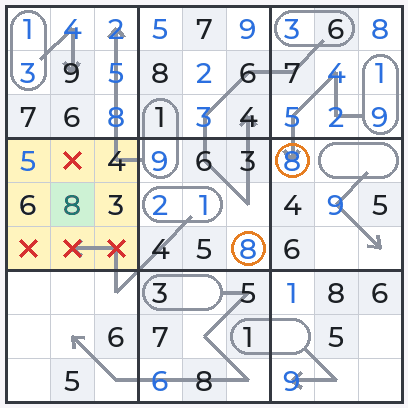

#### Step 29: the 7 in box 5

Box 5 needs a 7, and r5c6 is its last empty cell: **r5c6 = 7**.

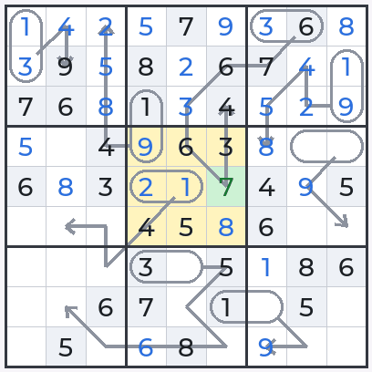

#### Step 30: the 1 in box 7

Box 7 needs a 1. r7c1, r7c2 and r7c3: row 7 has one (r7c7). r8c1 and r8c2: row 8 has one (r8c6). r9c1: column 1 has one (r1c1). Only **r9c3** is left: **r9c3 = 1**.

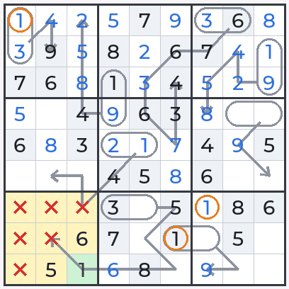

#### Step 31: the 3 in box 7

Box 7 needs a 3. r7c1, r7c2 and r7c3: row 7 has one (r7c4). r8c1 and r9c1: column 1 has one (r2c1). Only **r8c2** is left: **r8c2 = 3**.

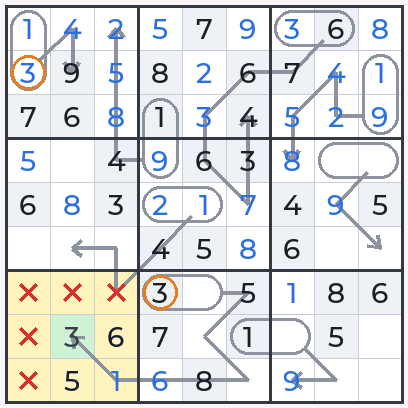

#### Step 32: the 8 in box 7

Box 7 needs an 8. r7c1, r7c2 and r7c3: row 7 has one (r7c8). r9c1: row 9 has one (r9c5). Only **r8c1** is left: **r8c1 = 8**.

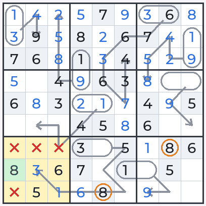

#### Step 33: the 2 in box 8

Box 8 needs a 2. r7c5 and r8c5: column 5 has one (r2c5). Only **r9c6** is left: **r9c6 = 2**.

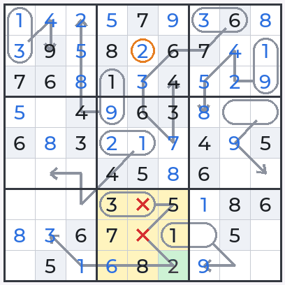

#### Step 34: the 4 in box 8

Box 8 needs a 4. r8c5: with a 4 on its shaft, the pill couldn't read as the shaft's sum. Only **r7c5** is left: **r7c5 = 4**.

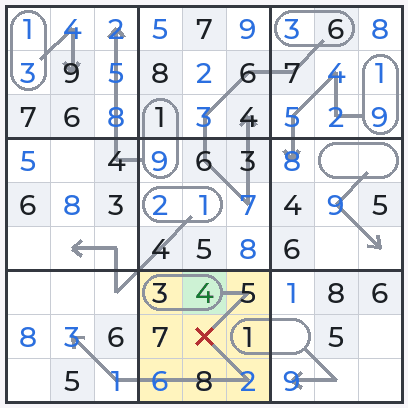

#### Step 35: the 4 in box 7

Box 7 needs a 4. r7c1, r7c2 and r7c3: row 7 has one (r7c5). Only **r9c1** is left: **r9c1 = 4**.

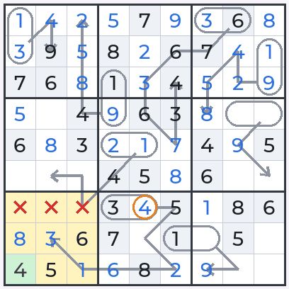

#### Step 36: the 9 in box 8

Box 8 needs a 9, and r8c5 is its last empty cell: **r8c5 = 9**.

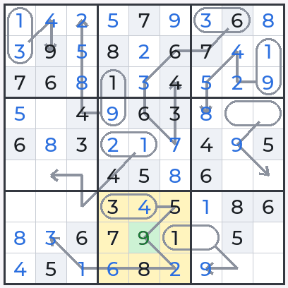

#### Step 37: the 4 in box 9

Box 9 needs a 4. r8c7: column 7 has one (r5c7). r9c8 and r9c9: row 9 has one (r9c1). Only **r8c9** is left: **r8c9 = 4**.

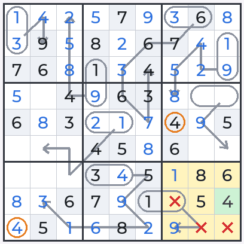

#### Step 38: the 2 in box 9

Box 9 needs a 2. r9c8 and r9c9: row 9 has one (r9c6). Only **r8c7** is left: **r8c7 = 2**.

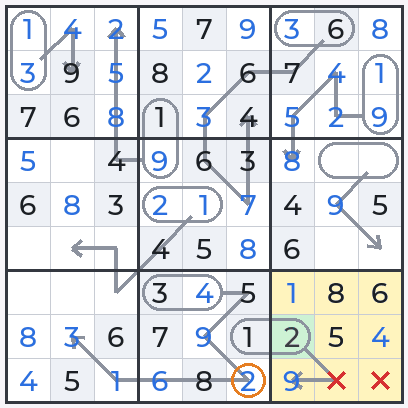

#### Step 39: the 7 in box 9

Box 9 needs a 7. r9c8: the pill reads 12 and the rest of the shaft makes 9, so it's 3. Only **r9c9** is left: **r9c9 = 7**.

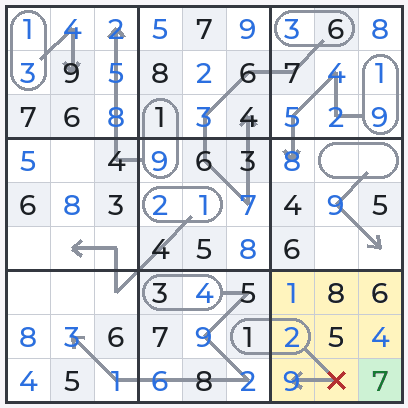

#### Step 40: the 7 in box 6

Box 6 needs a 7. r4c9 and r6c9: column 9 has one (r9c9). r4c8: it's a pill's first digit, its tens: a shaft of up to 7 cells adds up to 63 at most. Only **r6c8** is left: **r6c8 = 7**.

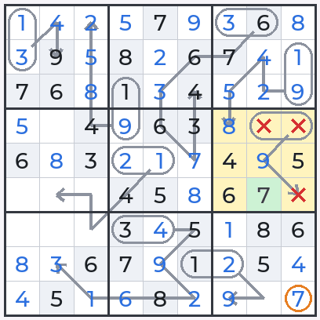

#### Step 41: the 7 in box 4

Box 4 needs a 7. r6c1, r6c2 and r6c3: row 6 has one (r6c8). Only **r4c2** is left: **r4c2 = 7**.

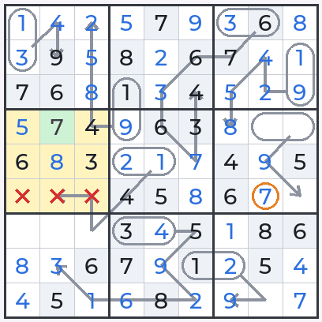

#### Step 42: the 1 in box 4

Box 4 needs a 1. r6c1: column 1 has one (r1c1). r6c3: column 3 has one (r9c3). Only **r6c2** is left: **r6c2 = 1**.

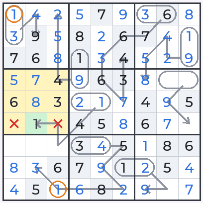

#### Step 43: the 2 in box 4

Box 4 needs a 2. r6c3: column 3 has one (r1c3). Only **r6c1** is left: **r6c1 = 2**.

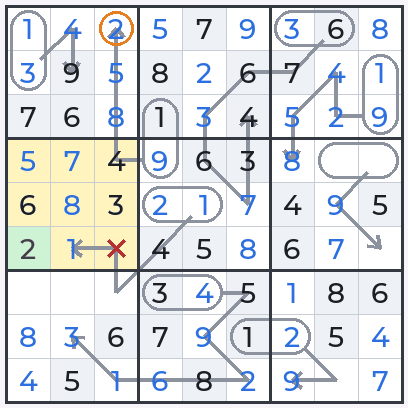

#### Step 44: the 9 in box 4

Box 4 needs a 9, and r6c3 is its last empty cell: **r6c3 = 9**.

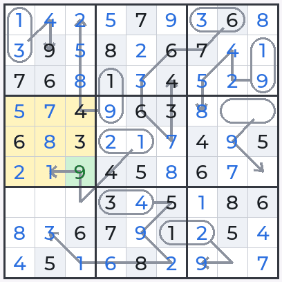

#### Step 45: the 1 in box 6

Box 6 needs a 1. r4c9: column 9 has one (r2c9). r6c9: row 6 has one (r6c2). Only **r4c8** is left: **r4c8 = 1**.

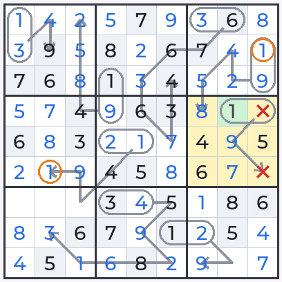

#### Step 46: the 2 in box 6

Box 6 needs a 2. r6c9: row 6 has one (r6c1). Only **r4c9** is left: **r4c9 = 2**.

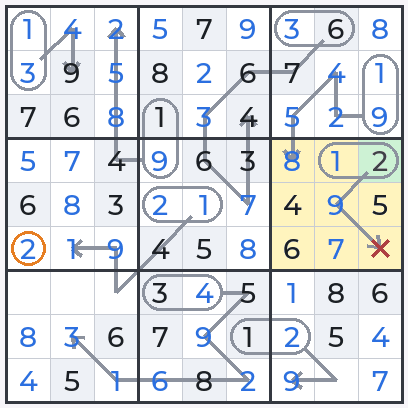

#### Step 47: the 3 in box 6

Box 6 needs a 3, and r6c9 is its last empty cell: **r6c9 = 3**.

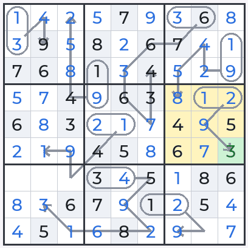

#### Step 48: the 2 in box 7

Box 7 needs a 2. r7c1: column 1 has one (r6c1). r7c3: column 3 has one (r1c3). Only **r7c2** is left: **r7c2 = 2**.

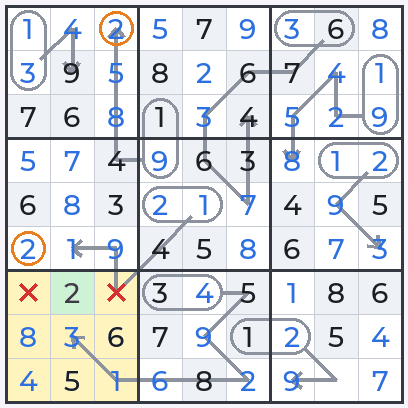

#### Step 49: the 7 in box 7

Box 7 needs a 7. r7c1: column 1 has one (r3c1). Only **r7c3** is left: **r7c3 = 7**.

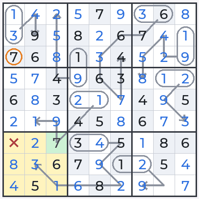

#### Step 50: the 9 in box 7

Box 7 needs a 9, and r7c1 is its last empty cell: **r7c1 = 9**.

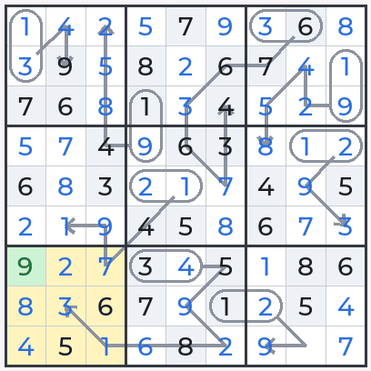

#### Step 51: the 3 in box 9

Box 9 needs a 3, and r9c8 is its last empty cell: **r9c8 = 3**.

Solved.

<!-- /walkthrough -->
