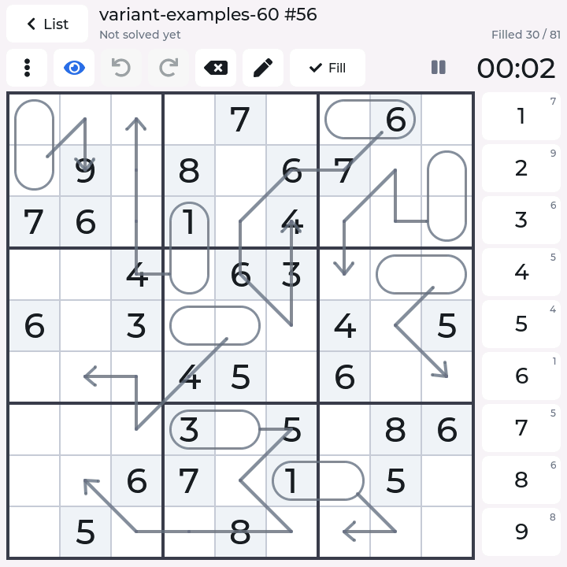
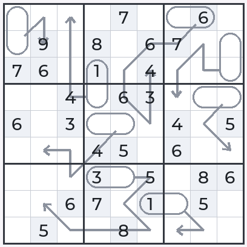

# Pill Arrows

[← All variants](README.md) · [Puzzles](../features-puzzles.md) · [How to play](../how-to-play.md)

## The rules

[Classic](classic.md) rules, and **arrows** whose circle is a **pill**: two cells side by side (or one above the other) in a capsule, read as a **two-digit number**, left to right or top to bottom. The digits along the arrow's shaft **add up to that number**. A pill of 1 and 2 reads 12, so its shaft could be 3, 4, 5. Digits may repeat along a shaft where the rules allow.

## On the board

- The pill is a grey capsule over two cells; the shaft runs from its second cell to an arrowhead.
- With the pill filled, the arrow's digits turn red when the shaft adds up to more than it (counting 1 for each empty cell), or, all filled, to something else.
- The grader and hints: "The arrow's shaft adds up to its pill, the two cells read as a two-digit number, so row 5, column 4 can only be 2."
- **Puzzles → ⋮ → New puzzle → Lines → Pill Arrow**: 8 arrows (Hard and Expert: 10); the generator keeps pills under 40.

## How to solve it

- **The pill's first digit is small:** a shaft of n cells adds up to 9n at most, so a pill on a 3-cell shaft is under 28: its tens are 1 or 2.
- **The tens do most of the work:** a pill of 2x needs a shaft of 20 to 29.
- **Then the units:** with the shaft filled but one cell, the pill's last digit, or the shaft's, is a subtraction.

## Worked example

**variant-examples #56**, Pill Arrows Easy (see [Classic](classic.md#worked-example-the-whole-puzzle) for how to import the examples; cells are written r*row*c*column*).

**Step 1: r5c4.** Column 4 has 1, 7 and 8; row 5 has 3, 4, 5 and 6: that leaves 2 and 9. r5c4 is the first cell of a pill (with r5c5), whose shaft has 4 cells: 4 cells add up to 36 at most, and a pill starting with 9 is 91 or more. **r5c4 = 2**.

**Step 2: the 5 in column 7.** r1c7 is the first cell of a pill with the 6 in r1c8. Its shaft of 7 cells holds 7, 6, 6, 3 and 4 (26) and two empty cells, so it adds up to 44 at most (both can be 9: they share no row, column or box): a pill of 56 is too much. Of the rest, r2c7, r5c7 and r6c7 are filled, r4c7 sees the 5 in r5c9, r7c7 the one in r7c6, r8c7 the one in r8c8 and r9c7 the one in r9c2. **r3c7 = 5**.

**Step 3: the 8 in column 7**, the same way: a pill of 86 is far too much for r1c7. **r4c7 = 8**.

## The whole puzzle, step by step

<!-- walkthrough -->
<!-- Written by tools/walkthrough.py pill-arrows: edit the script, not this part. -->

The whole puzzle, from the start to the last cell: 51 steps, each one a single (one place left for a digit, or one digit left for a cell), taken in the order a box's single comes first, so not quite the order of the worked example above. Each step has a page of its own, with **Previous** and **Next**: pick its number below. In each picture, the unit the step looks at is tinted yellow (for a cell with one digit left: its row, column and box), the new digit is on green, the digits that rule cells out have an **orange ring**, and the empty cells they rule out a **red cross**. Givens are on grey, digits from earlier steps in blue.

| [1](pill-arrows/step-01.md) | [2](pill-arrows/step-02.md) | [3](pill-arrows/step-03.md) | [4](pill-arrows/step-04.md) | [5](pill-arrows/step-05.md) | [6](pill-arrows/step-06.md) | [7](pill-arrows/step-07.md) | [8](pill-arrows/step-08.md) | [9](pill-arrows/step-09.md) | [10](pill-arrows/step-10.md) |
|:-:|:-:|:-:|:-:|:-:|:-:|:-:|:-:|:-:|:-:|
| [11](pill-arrows/step-11.md) | [12](pill-arrows/step-12.md) | [13](pill-arrows/step-13.md) | [14](pill-arrows/step-14.md) | [15](pill-arrows/step-15.md) | [16](pill-arrows/step-16.md) | [17](pill-arrows/step-17.md) | [18](pill-arrows/step-18.md) | [19](pill-arrows/step-19.md) | [20](pill-arrows/step-20.md) |
| [21](pill-arrows/step-21.md) | [22](pill-arrows/step-22.md) | [23](pill-arrows/step-23.md) | [24](pill-arrows/step-24.md) | [25](pill-arrows/step-25.md) | [26](pill-arrows/step-26.md) | [27](pill-arrows/step-27.md) | [28](pill-arrows/step-28.md) | [29](pill-arrows/step-29.md) | [30](pill-arrows/step-30.md) |
| [31](pill-arrows/step-31.md) | [32](pill-arrows/step-32.md) | [33](pill-arrows/step-33.md) | [34](pill-arrows/step-34.md) | [35](pill-arrows/step-35.md) | [36](pill-arrows/step-36.md) | [37](pill-arrows/step-37.md) | [38](pill-arrows/step-38.md) | [39](pill-arrows/step-39.md) | [40](pill-arrows/step-40.md) |
| [41](pill-arrows/step-41.md) | [42](pill-arrows/step-42.md) | [43](pill-arrows/step-43.md) | [44](pill-arrows/step-44.md) | [45](pill-arrows/step-45.md) | [46](pill-arrows/step-46.md) | [47](pill-arrows/step-47.md) | [48](pill-arrows/step-48.md) | [49](pill-arrows/step-49.md) | [50](pill-arrows/step-50.md) |
| [51](pill-arrows/step-51.md) |  |  |  |  |  |  |  |  |  |

Solved.

<!-- /walkthrough -->
