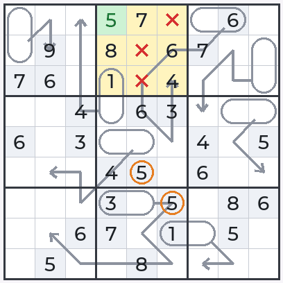

<!-- Written by tools/walkthrough.py pill-arrows: edit the script, not this page. -->
# Pill Arrows, step 1: the 5 in box 2

**Step 1 of 51** · [← The start](../pill-arrows.md#the-whole-puzzle-step-by-step) · [All steps](../pill-arrows.md#the-whole-puzzle-step-by-step) · [Step 2 →](step-02.md)

Box 2 needs a 5. r1c6: column 6 has one (r7c6). r2c5 and r3c5: column 5 has one (r6c5). Only **r1c4** is left: **r1c4 = 5**.

**Step 1 of 51** · [← The start](../pill-arrows.md#the-whole-puzzle-step-by-step) · [All steps](../pill-arrows.md#the-whole-puzzle-step-by-step) · [Step 2 →](step-02.md)
