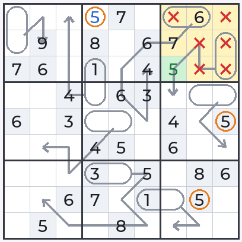

<!-- Written by tools/walkthrough.py pill-arrows: edit the script, not this page. -->
# Pill Arrows, step 2: the 5 in box 3

**Step 2 of 51** · [← Step 1](step-01.md) · [All steps](../pill-arrows.md#the-whole-puzzle-step-by-step) · [Step 3 →](step-03.md)

Box 3 needs a 5. r1c7 and r1c9: row 1 has one (r1c4). r2c8 and r3c8: column 8 has one (r8c8). r2c9 and r3c9: column 9 has one (r5c9). Only **r3c7** is left: **r3c7 = 5**.

**Step 2 of 51** · [← Step 1](step-01.md) · [All steps](../pill-arrows.md#the-whole-puzzle-step-by-step) · [Step 3 →](step-03.md)
