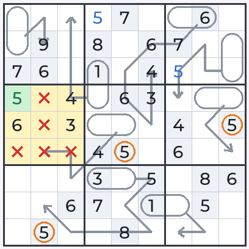

<!-- Written by tools/walkthrough.py pill-arrows: edit the script, not this page. -->
# Pill Arrows, step 3: the 5 in box 4

**Step 3 of 51** · [← Step 2](step-02.md) · [All steps](../pill-arrows.md#the-whole-puzzle-step-by-step) · [Step 4 →](step-04.md)

Box 4 needs a 5. r4c2: column 2 has one (r9c2). r5c2: row 5 has one (r5c9). r6c1, r6c2 and r6c3: row 6 has one (r6c5). Only **r4c1** is left: **r4c1 = 5**.

**Step 3 of 51** · [← Step 2](step-02.md) · [All steps](../pill-arrows.md#the-whole-puzzle-step-by-step) · [Step 4 →](step-04.md)
