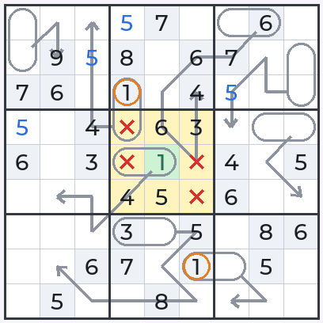

<!-- Written by tools/walkthrough.py pill-arrows: edit the script, not this page. -->
# Pill Arrows, step 5: the 1 in box 5

**Step 5 of 51** · [← Step 4](step-04.md) · [All steps](../pill-arrows.md#the-whole-puzzle-step-by-step) · [Step 6 →](step-06.md)

Box 5 needs a 1. r4c4 and r5c4: column 4 has one (r3c4). r5c6 and r6c6: column 6 has one (r8c6). Only **r5c5** is left: **r5c5 = 1**.

**Step 5 of 51** · [← Step 4](step-04.md) · [All steps](../pill-arrows.md#the-whole-puzzle-step-by-step) · [Step 6 →](step-06.md)
