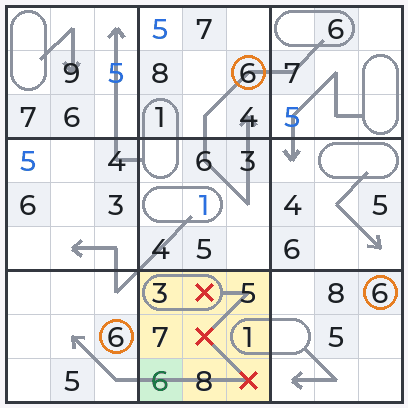

<!-- Written by tools/walkthrough.py pill-arrows: edit the script, not this page. -->
# Pill Arrows, step 6: the 6 in box 8

**Step 6 of 51** · [← Step 5](step-05.md) · [All steps](../pill-arrows.md#the-whole-puzzle-step-by-step) · [Step 7 →](step-07.md)

Box 8 needs a 6. r7c5: row 7 has one (r7c9). r8c5: row 8 has one (r8c3). r9c6: column 6 has one (r2c6). Only **r9c4** is left: **r9c4 = 6**.

**Step 6 of 51** · [← Step 5](step-05.md) · [All steps](../pill-arrows.md#the-whole-puzzle-step-by-step) · [Step 7 →](step-07.md)
