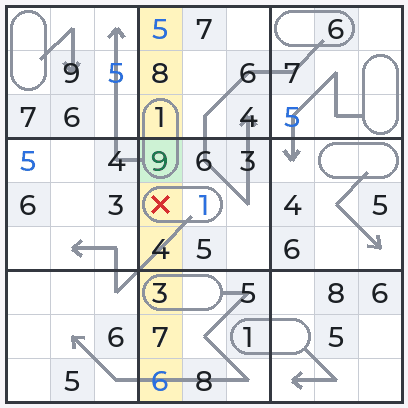

<!-- Written by tools/walkthrough.py pill-arrows: edit the script, not this page. -->
# Pill Arrows, step 7: the 9 in column 4

**Step 7 of 51** · [← Step 6](step-06.md) · [All steps](../pill-arrows.md#the-whole-puzzle-step-by-step) · [Step 8 →](step-08.md)

Column 4 needs a 9. r5c4: it's a pill's first digit, its tens: a shaft of up to 7 cells adds up to 63 at most. Only **r4c4** is left: **r4c4 = 9**.

**Step 7 of 51** · [← Step 6](step-06.md) · [All steps](../pill-arrows.md#the-whole-puzzle-step-by-step) · [Step 8 →](step-08.md)
