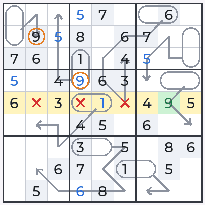

<!-- Written by tools/walkthrough.py pill-arrows: edit the script, not this page. -->
# Pill Arrows, step 8: the 9 in row 5

**Step 8 of 51** · [← Step 7](step-07.md) · [All steps](../pill-arrows.md#the-whole-puzzle-step-by-step) · [Step 9 →](step-09.md)

Row 5 needs a 9. r5c2: column 2 has one (r2c2). r5c4: column 4 has one (r4c4). r5c6: box 5 has one (r4c4). Only **r5c8** is left: **r5c8 = 9**.

**Step 8 of 51** · [← Step 7](step-07.md) · [All steps](../pill-arrows.md#the-whole-puzzle-step-by-step) · [Step 9 →](step-09.md)
