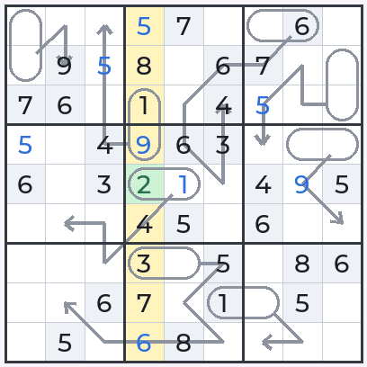

<!-- Written by tools/walkthrough.py pill-arrows: edit the script, not this page. -->
# Pill Arrows, step 9: the 2 in column 4

**Step 9 of 51** · [← Step 8](step-08.md) · [All steps](../pill-arrows.md#the-whole-puzzle-step-by-step) · [Step 10 →](step-10.md)

Column 4 needs a 2, and r5c4 is its last empty cell: **r5c4 = 2**.

**Step 9 of 51** · [← Step 8](step-08.md) · [All steps](../pill-arrows.md#the-whole-puzzle-step-by-step) · [Step 10 →](step-10.md)
